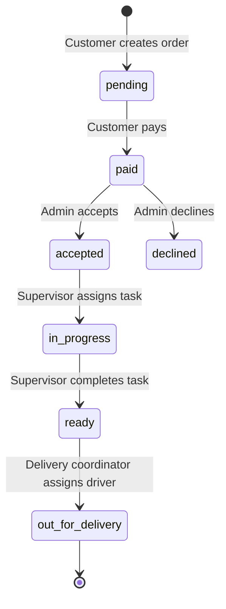
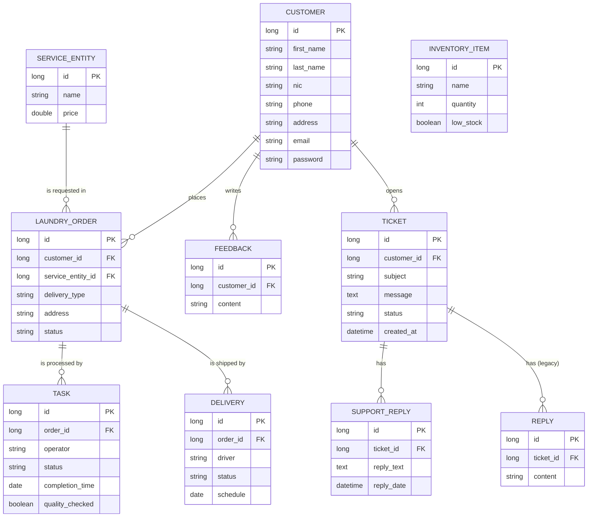

# 🧺 Laundry Management System

A role-based web application that manages the full life-cycle of a laundry business: customers place and pay for orders online, an admin approves them, a supervisor assigns the washing work, a delivery coordinator ships the finished laundry, and a support agent handles tickets and feedback. It is built with **Spring Boot**, **Thymeleaf** and **Microsoft SQL Server**.

> **Project code:** `Y02S01` (Year 2, Semester 1 academic project)


---

## 📑 Table of Contents

1. [Overview](#-overview)
2. [Features](#-features)
3. [Order Life-Cycle](#-order-life-cycle)
4. [Tech Stack](#-tech-stack)
5. [Architecture](#-architecture)
6. [Project Structure](#-project-structure)
7. [Data Model](#-data-model)
8. [Getting Started](#-getting-started)
9. [Configuration](#-configuration)
10. [Default Staff Accounts](#-default-staff-accounts)
11. [Usage Guide](#-usage-guide)
12. [Route Reference](#-route-reference)
13. [Testing](#-testing)
14. [Known Limitations & Roadmap](#-known-limitations--roadmap)
15. [Contributors](#-contributors)

---

## 🔎 Overview

The system has **six roles**, each with its own dashboard:

| Role | Purpose |
|------|---------|
| **Customer** | Register, place laundry orders, pay, send feedback and raise support tickets |
| **Admin** | Manage the service catalogue (names and prices) and accept or decline orders |
| **Supervisor** | Assign accepted orders to operators, mark tasks complete, record quality checks |
| **Delivery Coordinator** | Assign drivers and delivery dates to ready orders and track delivery status |
| **Inventory Manager** | Track consumables (detergent, hangers, etc.) and see low-stock alerts |
| **Customer Support** | Answer tickets, read feedback and view customer profiles with their order history |

It is a classic server-rendered MVC app: controllers return Thymeleaf views, Spring Data JPA repositories talk directly to SQL Server, and the logged-in user is tracked in the HTTP session.

---

## ✨ Features

### 👤 Customer
- Self-registration (first name, last name, NIC, phone, address, email, password) and email/password login.
- **Dashboard** listing all of the customer's orders and their current status.
- **Create an order**: pick a service from the catalogue and choose **Delivery** (with an address) or **In-Store Pickup**.
- **Payment page** (simulated, see [limitations](#-known-limitations--roadmap)) that marks the order as paid.
- **Submit feedback** about the service.
- **Support tickets**: open a ticket with a subject and message, view replies from support, and reply back.

### 🛠 Admin
- **Set Services**: add, update and delete services and their prices.
- **Manage Orders**: view every order and **accept** or **decline** it.

### 🧑‍🏭 Supervisor
- Sees all *accepted* orders.
- **Assign task** to a named operator (the order moves to *in progress*).
- **Complete task** (stamps the completion time and marks the order *ready*).
- **Quality check** flag on each task.

### 🚚 Delivery Coordinator
- Sees orders that are **ready** and set to **delivery**.
- **Assign a delivery** with a driver name and a scheduled date (the order moves to *out for delivery*).
- Update delivery status: *Assigned → In Transit → Delivered*.

### 📦 Inventory Manager
- Add inventory items with a quantity and update quantities later.
- Items below **10 units** are automatically flagged as **low stock**.

### 🎧 Customer Support
- Single dashboard of all tickets with their reply threads, plus all customer feedback.
- Reply to tickets, and edit or delete older replies.
- Open a **customer profile** page showing the customer's details and orders.
- Standalone **All Feedbacks** page.

---

## 🔄 Order Life-Cycle



| Status | Set by | Meaning |
|--------|--------|---------|
| `pending` | Customer (create order) | Order created, awaiting payment |
| `paid` | Customer (payment) | Payment submitted |
| `accepted` / `declined` | Admin | Order approved or rejected |
| `in_progress` | Supervisor | Operator has been assigned |
| `ready` | Supervisor | Laundry finished |
| `out_for_delivery` | Delivery coordinator | Driver assigned (delivery orders only) |

Delivery records have their own status: `assigned`, `in_transit`, `delivered`. Support tickets use `OPEN`, `IN_PROGRESS`, `RESOLVED`.

---

## 🧰 Tech Stack

| Layer | Technology |
|-------|-----------|
| Language | Java 21 |
| Framework | Spring Boot 3.3.4 (Spring Web MVC, Spring Data JPA) |
| View layer | Thymeleaf, HTML5, per-page CSS, small vanilla JS snippets |
| Database | Microsoft SQL Server (`mssql-jdbc`, runtime scope) |
| ORM | Hibernate / JPA (`ddl-auto=update`) |
| Testing | JUnit 5, Spring Boot Test |
| Build | Maven (Maven Wrapper included, Maven 3.9.11) |
| Packaging | Executable JAR |

---

## 🏗 Architecture

```
┌────────────┐   HTTP    ┌──────────────────────────┐   JPA    ┌──────────────┐
│  Browser   │ ────────▶ │       Controllers        │ ───────▶ │ Repositories │ ──▶ SQL Server
│ (Thymeleaf │ ◀──────── │ Auth · Customer · Admin  │          │ Spring Data  │
│   views)   │   HTML    │ Supervisor · Delivery ·  │          └──────────────┘
└────────────┘           │ Inventory · Support      │
                         └──────────────────────────┘
                              │  HttpSession ("userType", "userId")
```

- There is **no separate service layer**: controllers call the repositories directly.
- **Access control** is a session check at the top of each page handler: `userType` is one of `customer`, `admin`, `inventory`, `supervisor`, `support` or `delivery`. If it does not match, the user is redirected to the relevant login page.
- `WebConfig` registers a `String → LocalDate` converter so date inputs (e.g. delivery schedule) bind correctly.

---

## 📂 Project Structure

```
Y02S01-LaundrySystem/
├── .mvn/wrapper/                  # Maven Wrapper config
├── mvnw, mvnw.cmd                 # Maven Wrapper scripts
├── pom.xml
├── README.md
└── src/
    ├── main/
    │   ├── java/com/example/laundry/
    │   │   ├── LaundryApplication.java        # Entry point
    │   │   ├── config/WebConfig.java          # String -> LocalDate converter
    │   │   ├── controller/
    │   │   │   ├── AuthController.java        # Home, customer/staff login, register, logout
    │   │   │   ├── CustomerController.java    # Dashboard, orders, payment, feedback, tickets
    │   │   │   ├── AdminController.java       # Services + order approval
    │   │   │   ├── SupervisorController.java  # Tasks + quality checks
    │   │   │   ├── DeliveryController.java    # Driver assignment + delivery status
    │   │   │   ├── InventoryController.java   # Stock management
    │   │   │   └── SupportController.java     # Tickets, replies, feedback, customer profiles
    │   │   ├── entity/                        # JPA entities (see Data Model)
    │   │   └── repository/                    # One Spring Data repository per entity
    │   └── resources/
    │       ├── application.properties
    │       ├── static/css/                    # One stylesheet per page + background image
    │       └── templates/                     # 20 Thymeleaf pages
    └── test/java/com/example/laundry/
        └── LaundryApplicationTests.java
```

---

## 🗄 Data Model

Tables are generated automatically by Hibernate on startup. Primary keys are auto-incremented `Long` identities.



> The `Order` entity maps to the table `laundry_order` because `order` is a reserved SQL word. `ServiceEntity` is named that way to avoid a keyword clash with "service".

---

## 🚀 Getting Started

### Prerequisites

| Requirement | Version / Notes |
|-------------|-----------------|
| **JDK** | 21 |
| **Microsoft SQL Server** | Running on `localhost:1433`, with **TCP/IP enabled** and **SQL Server authentication** (mixed mode) |
| **Maven** | Not required; the included wrapper (`mvnw`) downloads Maven 3.9.11 |
| **Git** | To clone the repository |

### 1. Clone the repository

```bash
git clone https://github.com/ThemiyaDeshan/Y02S01-LaundrySystem.git
cd Y02S01-LaundrySystem
```

### 2. Create the database

Using SQL Server Management Studio, Azure Data Studio or `sqlcmd`:

```sql
CREATE DATABASE LaundrySystem;
```

> Hibernate creates all tables on first start. You only need an empty database.

### 3. Configure the connection

Edit `src/main/resources/application.properties` with your own SQL Server username and password (see [Configuration](#-configuration)).

### 4. Run the application

**Linux / macOS**
```bash
./mvnw spring-boot:run
```

**Windows**
```powershell
mvnw.cmd spring-boot:run
```

Open **http://localhost:8080**. The landing page links to the customer and staff portals.

### 5. Build a runnable JAR (optional)

```bash
./mvnw clean package
java -jar target/laundry-0.0.1-SNAPSHOT.jar
```

### 6. First-time data setup

The database starts empty, and customers cannot create an order until at least one service exists. Seed it in this order:

1. Go to `/staff/login` and sign in as **Admin** (see [Default Staff Accounts](#-default-staff-accounts)).
2. Open **Set Services** and add services such as *Wash & Fold* or *Dry Cleaning* with prices.
3. Register a customer at `/customer/register`, then log in at `/customer/login`.
4. Optionally sign in as **InManager** to add inventory items.

---

## ⚙️ Configuration

`src/main/resources/application.properties`

| Property | Default | Description |
|----------|---------|-------------|
| `spring.application.name` | `Laundry` | Application name |
| `spring.datasource.url` | `jdbc:sqlserver://localhost:1433;databaseName=LaundrySystem;encrypt=false;trustServerCertificate=true` | JDBC URL: host, port, database name |
| `spring.datasource.username` | `sa` | SQL Server login |
| `spring.datasource.password` | *(set in file)* | SQL Server password |
| `spring.datasource.driverClassName` | `com.microsoft.sqlserver.jdbc.SQLServerDriver` | JDBC driver |
| `spring.jpa.hibernate.ddl-auto` | `update` | Auto-create / evolve the schema |
| `spring.jpa.show-sql` | `true` | Log generated SQL |
| `spring.jpa.properties.hibernate.dialect` | `SQLServerDialect` | Hibernate dialect |
| `spring.thymeleaf.cache` | `false` | Disable template caching (development) |

### Overriding settings without editing the file

```bash
export SPRING_DATASOURCE_URL="jdbc:sqlserver://localhost:1433;databaseName=LaundrySystem;encrypt=false;trustServerCertificate=true"
export SPRING_DATASOURCE_USERNAME="your_user"
export SPRING_DATASOURCE_PASSWORD="your_password"
./mvnw spring-boot:run
```

To change the web port, set `SERVER_PORT=9090` (or `server.port=9090`).

The `.gitignore` already excludes `application-local.properties`, so you can keep machine-specific settings there and run with `--spring.profiles.active=local`.

---

## 🔑 Default Staff Accounts

Staff accounts are **hard-coded** in `AuthController` (there is no staff table). Sign in at **`/staff/login`**:

| Role | Username | Password | Lands on |
|------|----------|----------|----------|
| Admin | `Admin` | `Admin123` | `/admin/dashboard` |
| Inventory Manager | `InManager` | `InManager123` | `/inventory/dashboard` |
| Supervisor | `Supervisor` | `Supervisor123` | `/supervisor/dashboard` |
| Customer Support | `CustSupport` | `CustSupport123` | `/support/dashboard` |
| Delivery Coordinator | `DelCoord` | `DelCoord123` | `/delivery/dashboard` |

> ⚠️ These are demo credentials. Change them, or move staff into the database with hashed passwords, before any real deployment.

Customers sign in separately at **`/customer/login`** with the email and password they registered with.

---

## 📖 Usage Guide

An end-to-end walkthrough using all roles:

1. **Admin** adds services and prices at *Set Services*.
2. **Customer** registers, logs in and clicks *Create Order*. They pick a service and either *Delivery* (entering an address) or *In-Store Pickup*, then land on the payment page and pay. The order shows as **paid** on their dashboard.
3. **Admin** opens *Manage Orders* and **accepts** (or declines) the order.
4. **Supervisor** sees the accepted order, **assigns** it to an operator (order becomes *in progress*), then clicks **Complete** when the work is done (order becomes *ready*). The **Quality check** button flags the task as inspected.
5. **Delivery Coordinator** sees ready delivery orders, enters a **driver** and **date** to assign, then updates the delivery to *In Transit* and *Delivered*.
6. **Customer** can at any point submit **feedback** or open a **support ticket**.
7. **Support** answers tickets from the support dashboard; the customer sees the replies and can respond in the same thread.
8. **Inventory Manager** keeps stock levels up to date; anything under 10 units is flagged as low stock.

---

## 🛣 Route Reference

### Public / Auth

| Method | Path | Description |
|--------|------|-------------|
| GET | `/` | Landing page |
| GET / POST | `/customer/register` | Customer registration |
| GET / POST | `/customer/login` | Customer login |
| GET / POST | `/staff/login` | Staff login (all staff roles) |
| GET | `/logout` | End the session |
| GET | `/all-feedbacks` | List of all customer feedback |

### Customer (`userType = customer`)

| Method | Path | Description |
|--------|------|-------------|
| GET | `/customer/dashboard` | Profile summary and the customer's orders |
| GET / POST | `/customer/create-order` | Choose a service and delivery type |
| GET | `/customer/pay/{orderId}` | Payment page |
| POST | `/customer/pay` | Submit (simulated) payment |
| GET / POST | `/customer/submit-feedback` | Send feedback |
| GET / POST | `/customer/submit-ticket` | View tickets with replies / open a ticket |
| POST | `/customer/add-reply` | Reply on an existing ticket |

### Admin (`userType = admin`)

| Method | Path | Description |
|--------|------|-------------|
| GET | `/admin/dashboard` | Admin home |
| GET | `/admin/set-services` | Service catalogue |
| POST | `/admin/add-service` | Add a service |
| GET | `/admin/update-service/{id}` | Edit form |
| POST | `/admin/update-service` | Save changes |
| POST | `/admin/delete-service/{id}` | Delete a service |
| GET | `/admin/manage-orders` | All orders |
| POST | `/admin/accept-order/{id}` | Accept an order |
| POST | `/admin/decline-order/{id}` | Decline an order |

### Supervisor (`userType = supervisor`)

| Method | Path | Description |
|--------|------|-------------|
| GET | `/supervisor/dashboard` | Accepted orders and tasks |
| POST | `/supervisor/assign-task` | Assign an order to an operator |
| POST | `/supervisor/complete-task/{id}` | Mark a task complete (order becomes ready) |
| POST | `/supervisor/check-quality/{id}` | Flag a task as quality-checked |

### Delivery (`userType = delivery`)

| Method | Path | Description |
|--------|------|-------------|
| GET | `/delivery/dashboard` | Ready delivery orders and all deliveries |
| POST | `/delivery/assign` | Assign driver and schedule |
| POST | `/delivery/update-status/{id}` | Set status (`assigned`, `in_transit`, `delivered`) |

### Inventory (`userType = inventory`)

| Method | Path | Description |
|--------|------|-------------|
| GET | `/inventory/dashboard` | All inventory items |
| POST | `/inventory/add-item` | Add an item |
| POST | `/inventory/update-item/{id}` | Update quantity (recomputes low-stock flag) |

### Support (`userType = support`)

| Method | Path | Description |
|--------|------|-------------|
| GET | `/support/dashboard` | Tickets, replies and feedback |
| POST | `/support/add-reply` | Reply to a ticket (threaded, timestamped) |
| POST | `/support/reply-ticket/{id}` | Add a legacy `Reply` to a ticket |
| GET | `/support/update-reply/{id}` | Edit a legacy reply |
| POST | `/support/update-reply` | Save an edited legacy reply |
| POST | `/support/delete-reply/{id}` | Delete a legacy reply |
| GET | `/support/customer-profile/{id}` | A customer's details and orders |

---

## 🧪 Testing

```bash
./mvnw test
```

The repository ships with a single Spring Boot context-load test (`LaundryApplicationTests`), which needs the SQL Server database from [Getting Started](#-getting-started) to be reachable. Good next tests: the order state transitions, the low-stock threshold and the access checks on each controller.

---

## ⚠️ Known Limitations & Roadmap

This is an academic/demo build. Please note the following before using it beyond a classroom or local environment.

**Security**
- Staff credentials are hard-coded in source (see [Default Staff Accounts](#-default-staff-accounts)).
- Customer passwords are stored and compared as **plain text**. Use BCrypt (Spring Security) for hashing.
- Page (`GET`) handlers check the session, but most **`POST` handlers do not** (for example `/admin/add-service`, `/admin/accept-order/{id}`, `/customer/pay`, `/inventory/add-item`). Anyone who can send a request could call them without logging in. `/all-feedbacks` is also open.
- No CSRF protection; no input validation on registration or forms.
- Database credentials are committed in `application.properties`. Move them to environment variables and rotate any that have been published.

**Functionality**
- **Payment is simulated.** The card number, expiry and CVV are accepted but not validated or stored; the order is simply marked `paid`.
- The support dashboard redirects unauthenticated users to `/support/login`, which does not exist (the real page is `/staff/login`).
- Two reply mechanisms coexist: the timestamped `SupportReply` (used by both customers and support to chat on a ticket) and an older `Reply` entity with edit/delete screens. Customers only see `SupportReply` messages. Consider consolidating them.
- Ticket status (`OPEN`, `IN_PROGRESS`, `RESOLVED`) is defined but there is no screen yet to change it.
- Pickup orders stop at `ready`; there is no "collected" step. Marking a delivery as `delivered` does not update the order status.
- Customer registration does not check for duplicate emails, and login uses `findByEmail` returning a single result.
- The admin can accept an order that has not been paid.
- The low-stock threshold (10) is hard-coded.

**Housekeeping**
- `HELP.md` is generated boilerplate that mentions Spring Security and Spring Boot 3.5.6, neither of which matches `pom.xml` (Spring Boot 3.3.4, no Spring Security).
- `src/main/resources/static/test` is an empty file and can be removed.
- Controllers are large and talk directly to repositories; extracting a service layer would make them easier to test.

**Ideas for the roadmap**
- [ ] Spring Security with role-based authorisation and hashed passwords
- [ ] Staff accounts and roles stored in the database
- [ ] Real payment-gateway integration or at least server-side validation
- [ ] Email / SMS notifications for order status changes
- [ ] Order items with quantity, weight and per-item pricing
- [ ] Reports and analytics for the admin (revenue, turnaround time)
- [ ] Ticket status workflow and assignment
- [ ] Docker Compose file with SQL Server for one-command setup
- [ ] Unit and integration tests

---

## 👥 Contributors

| GitHub | Role |
|--------|------|
| [@ThemiyaDeshan](https://github.com/ThemiyaDeshan) | Repository owner / contributor |

Contributions, issues and suggestions are welcome. Feel free to open an issue or submit a pull request.

---

## 📄 License

No license file is included in this repository. If you intend to share or reuse this code, add a `LICENSE` file (for example MIT) to make the terms explicit.

---

<p align="center">Built with ☕, Spring Boot and a lot of clean laundry 🧼</p>
